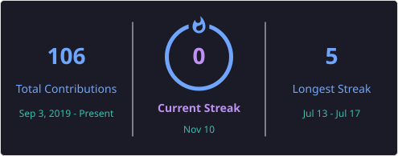

<!-- Animated Introduction -->
<h1 align="center">Hi 👋, I'm Hassan Kazmi</h1>

<h3 align="center">Aspiring Full-Stack Developer | JavaScript Enthusiast</h3>

  

---

### 👨‍💻 About Me

- 🌱 Currently learning Full-Stack Development
- 💻 Interested in JavaScript and modern web technologies
- 🚀 Building my AI productivity project – WriteFlow
- 🎯 Improving my problem-solving skills
- 🤝 Open to collaboration and learning opportunities

### 🛠️ Technologies & Tools

  

### 📊 GitHub Statistics

  
  

### 🔥 GitHub Streak

<h2>🔥 GitHub Streak</h2>

  

## 🐍 Contribution Snake

<h2 align="center">🐍 My Contribution Graph</h2>

  <picture>
    <source media="(prefers-color-scheme: dark)"
      srcset="https://raw.githubusercontent.com/hassankazmi025/hassankazmi025/output/github-snake-dark.svg">
    <source media="(prefers-color-scheme: light)"
      srcset="https://raw.githubusercontent.com/hassankazmi025/hassankazmi025/output/github-snake.svg">
    
  </picture>

### 🌐 Connect With Me

  

---

  <b>✨ Keep Learning | Keep Building | Keep Growing ✨</b>

